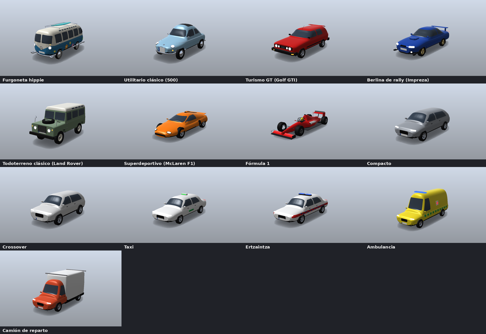
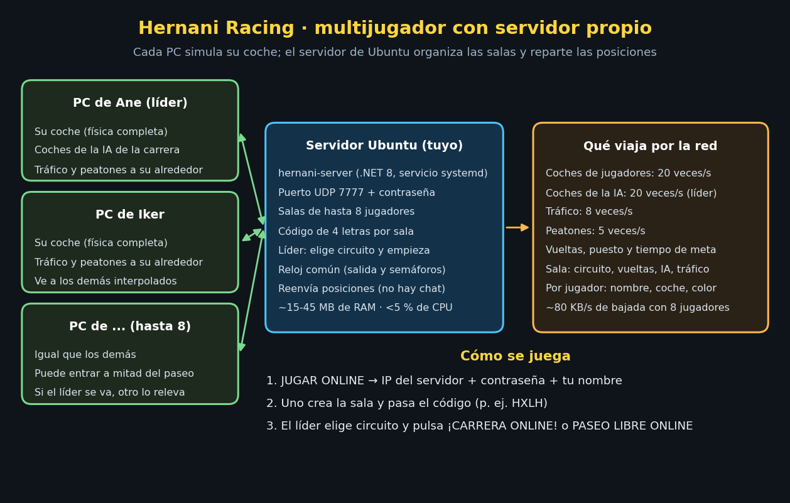
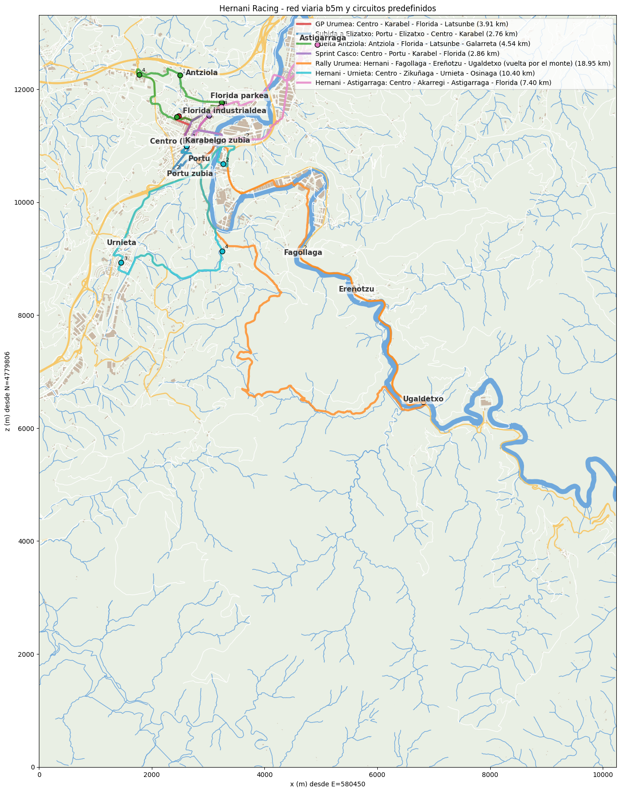

# Hernani Racing 🏁

Juego de carreras para **Unity** ambientado en **Hernani (Gipuzkoa)** con datos geográficos **reales**:
la red viaria, los edificios, el relieve, el río Urumea y la toponimia proceden de **b5m** (Diputación Foral
de Gipuzkoa) y de **geoEuskadi** (Gobierno Vasco). Los sentidos de circulación, semáforos, STOP, cedas y pasos de cebra
vienen de **OpenStreetMap**. Los coches son modelos 3D **propios**, generados por código (dominio público, CC0) e inspirados en coches clásicos reales.

El jugador **elige 4 cruces reales** del mapa: el juego une 1 → 2 → 3 → 4 → 1 por las calles más
cortas, cierra el circuito y lanza una carrera de **varias vueltas** contra la IA. No hay vallas ni bordillos: las calles
laterales quedan abiertas y la calzada va pegada al terreno real.
También hay un modo **Paseo libre**: conduces por todo Hernani sin carrera, con tráfico y peatones que respetan
las señales.

## Novedades (versión 10): online también desde el navegador
* **La versión web ya juega online**, en las **mismas salas** que los de PC: unos desde el .exe y otros desde Chrome/Edge/Firefox,
  todos juntos (carreras y paseo libre, hasta 8 por sala, con tráfico y peatones).
* El navegador no permite UDP, así que la versión web se conecta por **WebSocket**. El servidor de Ubuntu acepta los dos tipos de
  conexión a la vez: UDP 7777 para el PC y **TCP 8080** para la web.
* **El propio servidor sirve la página del juego**: basta con abrir **http://IP-del-servidor:8080** (sin dominio ni certificado).
  Para subir el juego web: haz el build WebGL en Unity y en el servidor ejecuta `sudo ./install-web.sh carpeta-o-zip-del-build`.
* Como en PC, el servidor por defecto viene configurado y sólo hay que escribir el nombre. Ojo: en la versión web los datos de
  conexión (también la contraseña) van dentro de los archivos de la página, así que quien tenga el enlace puede entrar.
* Los ejecutables de la v9 siguen sirviendo con el servidor nuevo (el protocolo no cambia). Hay que **actualizar el servidor** una vez
  (ver 5.2) y abrir el **puerto 8080 TCP** en el panel del proveedor.

## Novedades (versión 9): llegada justa, adelantamientos con cabeza y builds arreglados
* **Clasificación fijada en la meta.** El puesto y el tiempo de cada coche son los del momento exacto en que cruza la línea
  (interpolado dentro del fotograma). Los que ya han llegado van siempre delante, ordenados por su tiempo: ningún rival puede
  «adelantarte» en la tabla después de que hayas terminado. (Antes, un error de redondeo podía cambiar el orden de los que ya habían llegado.)
* **Vuelta de deceleración.** Al cruzar la meta cada coche (también el tuyo, con piloto automático) frena **poco a poco** en unos
  7 segundos y se aparta al lado derecho hasta pararse. Los coches que ya han terminado **no chocan** con los demás de la carrera.
  Los rivales que van por detrás siguen corriendo hasta cruzar la meta con su tiempo real
  (sólo si tardan más de 2 min y medio se les da un tiempo estimado, marcado con «≈»).
* **IA más prudente.** Cada rival mira qué hay en su calzada (los demás coches de la carrera, el tráfico en su sentido **y el que
  viene de frente**, y los peatones que cruzan) y elige el hueco más libre: adelanta sólo si cabe, no se cruza delante de un coche
  que lleva al lado y, si no hay hueco, se queda detrás guardando la distancia.
* **Atropellos: 2 segundos parado.** Si atropellas a un peatón, sale despedido, se cae (y luego se levanta) y tu coche frena hasta
  pararse y se queda quieto **2 segundos**, con la cuenta atrás en pantalla **2,000 → 0,000**. Vale en carrera (también para la IA)
  y en paseo libre.
* **Build de Windows (.exe): ya se ve el suelo.** El terreno se crea por código y Unity quitaba sus shaders del build. Ahora el
  terreno siempre lleva su material y, **antes de cada build**, se añaden solos los shaders del terreno a *Always Included Shaders*
  (no hace falta acordarse del menú 2).
* **Build WebGL: los coches ya no caen al vacío.** Con *Strip Engine Code* Unity eliminaba el colisionador del terreno
  (`TerrainCollider`), que sólo se crea en tiempo de ejecución. Ahora se añade explícitamente y `Assets/HernaniRacing/link.xml` protege
  los módulos de terreno y física. Además el minimapa detallado ya no usa hilos (WebGL no los tiene).
  (En la v9 el navegador aún no tenía modo online; desde la v10 sí, ver arriba.)

## Novedades (versión 8): coches nuevos, más tráfico y zoom del mapa
* **Coches nuevos, mucho más detallados** (≈ 20 000–32 000 triángulos cada uno, con versión ligera automática para cuando se ven de lejos).
  Están hechos por código con las medidas reales aproximadas de cada modelo, sin marcas ni logotipos:

  | En el juego | Inspirado en |
  |---|---|
  | Furgoneta hippie | Furgoneta T1 «Samba» de los 60 (bitono, 23 ventanas, baca y tabla de surf) |
  | Utilitario clásico | «500» de los 60 (techo de lona) |
  | Turismo GT | Compacto «GTI» de 2ª generación (faros dobles, filete rojo) |
  | Berlina de rally | Impreza WRX de 1ª generación (azul, llantas doradas, alerón y toma de capó) |
  | Todoterreno clásico | Land Rover «Serie IIA» (techo blanco, rueda en el capó, ventanas alpinas) |
  | Superdeportivo | McLaren F1 de 1992 (toma de aire en el techo, motor central) |
  | Fórmula 1 | Monoplaza actual genérico (halo, alerones, fondo plano) |

  

  En el tráfico salen además **compactos y SUV urbanos** actuales (los más frecuentes), **taxis**, **patrullas de la Ertzaintza**,
  **ambulancias** y **camiones de reparto**, cada uno con su frecuencia (casi nunca verás un superdeportivo).
  Cada coche tiene su física: el «500» es ligero y lento, el Impreza agarra mucho, el superdeportivo es el más rápido después del F1.
* **Cantidad de tráfico y peatones**: *No · Poco · Normal · Mucho · Muchísimo · A tope* (hasta 100 coches y 140 peatones alrededor).
  Salen más coches en la autovía y las carreteras que en las calles. Online el máximo es de 60 coches por jugador.
* **Tráfico según la hora real** (opcional): no hay datos de tráfico en tiempo real abiertos y gratuitos (Google Maps y Waze no los dan
  sin contrato), así que el juego usa el **perfil real de la A-15 en Hernani** (aforos de la Diputación Foral de Gipuzkoa publicados en
  Open Data Euskadi): el martes a las 8:00 hay hora punta y a las 4:00 de la madrugada casi nadie.
* **Pantalla de circuito rediseñada**: dos paneles (a la izquierda el circuito y a la derecha la carrera, el tráfico y los botones).
  Todo se lee sin barras de desplazamiento; si la ventana es pequeña, el panel se ajusta solo.
* **Zoom del minimapa** con **N**: 5 km → 2 km → 1 km → 500 m → 200 m → 100 m (en carrera, además, el circuito entero).
  En los zooms de 200 y 100 m el plano se dibuja con detalle (0,5 m por píxel).

## Novedades (versión 7): menús nuevos
* **Pantalla de presentación**: de fondo, la cámara **sobrevuela Hernani a unos 300 m del suelo y a 300 km/h**, como en una película,
  de barrio en barrio y al azar. Delante, los botones (**¡A CORRER!**, **PASEO LIBRE**, **JUGAR ONLINE**, **SALIR**) y tres tarjetas de resumen:
  * **Coche**: el coche elegido en 3D (girando) y el botón *Cambiar coche*.
  * **Circuito**: plano con el trazado, longitud, desnivel y barrios, y el botón *Cambiar circuito*.
  * **Carrera**: vueltas, **rivales de la IA (ahora hasta 8)** y dificultad.
* **Pantalla de coche**: todos los modelos dibujados en 3D con sus características (velocidad punta, aceleración, frenada, agarre, peso y medidas),
  y 12 colores.
* **Pantalla de circuito y carrera**: circuitos predefinidos sobre el mapa, circuito propio con 4 cruces, vueltas, IA y tráfico/peatones sí o no.
* **Pantalla de paseo libre**: punto de salida (un cruce del mapa, un barrio o el centro de Hernani) y tráfico/peatones sí o no.
* **Pantalla de jugar online**: el servidor por defecto ya viene configurado (sólo hay que escribir el nombre y conectar). Hay una pantalla de
  *Opciones de conexión* para cambiarlo. Crear sala, entrar con código y salas abiertas, con la lista actualizada cada 2 segundos.
* Todo lo elegido (coche, color, circuito, carrera, salida del paseo) **se guarda en el PC** para la próxima vez.

## Novedades (versión 6): multijugador online con servidor propio
* **Hasta 8 jugadores por sala**, cada uno desde su casa y su PC, conectados a **tu propio servidor Ubuntu**.
* **Carreras online** (con o sin coches de la IA, hasta 10 coches en total) y **paseo libre compartido** por todo el mapa.
* **Tráfico y peatones online**: los coches y peatones que ve un jugador los ven también los demás (cada PC mueve los de su
  alrededor y los envía al resto). Los semáforos van sincronizados con el reloj del servidor.
* **Salas con código de 4 letras**. El **líder** (quien crea la sala) elige el circuito, las vueltas, la IA y el tráfico; cada
  jugador elige su coche y su color. Si el líder se va, otro jugador pasa a ser líder y se queda con los coches de la IA.
* Al paseo libre se puede **entrar a mitad de partida**. No hay chat: sólo se comparten el nombre, el coche y la posición.
* Servidor ligero en **.NET 8** (`Server/`), con instalador para Ubuntu que lo deja como servicio. Se ha probado con 8 jugadores simulados:
  ningún paquete perdido, unos 80 KB/s de bajada por jugador y menos del 5 % de una CPU.



## Novedades (versión 5): todo el término de Hernani hasta Ugaldetxo
* **Área de 10,2 × 7,2 km** (antes 3 × 3 km): todo el término municipal de Hernani desde el límite norte (Antziola, Florida,
  Akarregi) hasta **Ugaldetxo** al sur, con unos 300 m más de valle para que la GI‑3410 no termine de golpe. No llega más al sur.
* Entra también lo que queda dentro del rectángulo: **Urnieta**, **Astigarraga**, **Ergobia**, **Epele**, **Fagollaga**,
  **Ereñotzu**, Santiagomendi, Añorga y parte de Martutene, con la A‑15, la AP‑8, la AP‑1, la GI‑2132, la GI‑3410 y la GI‑3721.
* Unos **565 km de calles y carreteras** (4.921 tramos), **6.751 edificios**, unos **206.000 árboles**, 1,4 km de túneles,
  163 cruces a distinto nivel, y señalización OSM de toda el área: 30 cruces con semáforos, 256 señales STOP y de ceda el paso, 546 pasos de cebra
  y 1.221 tramos de sentido único.
* **Nuevos circuitos predefinidos**: Hernani – Urnieta (10,4 km), Hernani – Astigarraga (7,4 km) y el **Rally Urumea** (19 km):
  sube el valle por la GI‑3410 hasta Ugaldetxo y vuelve por las pistas del monte.
* El terreno se divide en **70 teselas de 1 km** (heightmap de 2 m/píxel). El mapa de selección permite alejar el zoom hasta ver toda el área, y el mapa del HUD
  cubre todo el término.

## Novedades (versión 4)
* **Selector de coche**: turismo, berlina, utilitario, furgoneta, SUV, F1 y F1 futurista, cada uno con su
  masa, potencia, frenos, agarre y velocidad punta. Además puedes elegir el **color**. Los rivales llevan el mismo coche que tú.
* **Señalización real (OSM)**: sentidos únicos (flechas en el suelo y señal de dirección prohibida), **semáforos que
  funcionan** (ciclo verde/ámbar/rojo por cruce), STOP, ceda el paso, rotondas y pasos de cebra.
* **Marcas viales**: línea central continua o discontinua (continua cerca de cruces, en curvas, puentes y túneles), líneas de borde,
  líneas de detención y de ceda, flechas de sentido y cebreados.
* **Tráfico y peatones**: coches que circulan por su carril, respetan sentidos, semáforos, STOP, cedas, prioridad en
  rotondas y pasos de cebra, y frenan detrás de otros coches (y de ti). Los peatones pasean por las aceras y cruzan
  por los pasos de cebra, y se apartan si un coche va directo hacia ellos.
* **Cámara**: nunca queda por debajo del coche ni mira hacia arriba. Al ir marcha atrás gira y ves el coche **de frente**.
  **B** (mantener) = vista trasera.
* **Mapa**: minimapa con calles, edificios y río reales. **N** = zoom sobre tu posición (unos 100 m alrededor).
* **Flechas en el suelo**: chevrones amarillos que marcan por dónde sigue el circuito (**F** para ocultarlas).



---

## 1. Puesta en marcha (5 minutos)

Requisitos: **Unity 2021.3 LTS o posterior** (probado contra la API de 2021.3; hay ramas
`#if` para **Unity 6** y para el **nuevo Input System**). Vale Built‑in o URP.

1. En Unity Hub crea un proyecto nuevo **3D (Built‑in)** o **3D (URP)**.
2. Copia la carpeta `Assets/HernaniRacing` dentro del `Assets` de tu proyecto.
3. *(Opcional)* Copia `DataPipeline/` **junto a** `Assets/` (en la raíz del proyecto) si quieres regenerar los datos.
4. En Unity, en el menú **Hernani Racing → 1. Crear escena de juego**.
   Se crea `Assets/HernaniRacing/Scenes/Hernani.unity`, se añade a *Build Settings* y se
   registran los shaders necesarios.
5. Pulsa **Play**. Hay una pantalla de carga de unos segundos mientras se construye el mundo
   (terreno de 10,2 × 7,2 km en 70 teselas, unos 6.750 edificios, unos 206.000 árboles, calles, puentes y túneles).
   La primera carga tarda más que en la versión anterior (en un PC normal, entre 20 y 60 s).

> Si tu proyecto usa **solo** el nuevo Input System (lo habitual en Unity 6), el código lo detecta
> automáticamente. Con *Active Input Handling = Both* se usa el Input Manager clásico.

Para un ejecutable: *File → Build Settings → Build*. Antes de cada build se añaden solos los shaders que hacen
falta (materiales y terreno); si aun así algo sale rosa o invisible, ejecuta **Hernani Racing → 2. Incluir shaders para builds**
y vuelve a hacer el build.

**Build WebGL (navegador):** *File → Build Settings → WebGL → Switch Platform → Build*. Copia también
`Assets/HernaniRacing/link.xml` (va dentro de la carpeta `HernaniRacing`). Recomendado en *Player Settings → WebGL → Other
Settings*: *Managed Stripping Level = Minimal*; si aun así cayeran los coches, desmarca *Strip Engine Code*. El mundo es
grande: en *Publishing Settings* pon *Compression Format = **Gzip*** (Brotli sólo funciona por https) y, en *Other Settings →
Memory*, *Maximum Memory Size = 4096*. Prueba con Chrome o Edge en un PC. Para jugar online desde la web, súbelo a tu servidor
(apartado 5.4b).

---

## 2. Cómo se juega

### Menús
* **Presentación** (vuelo sobre Hernani): botones **¡A CORRER!** (carrera con lo que ves en las tarjetas), **PASEO LIBRE**, **JUGAR ONLINE** y **SALIR**.
  Las tarjetas resumen el **coche**, el **circuito** y la **carrera**; en la de carrera se cambian las **vueltas** (1–20), los **rivales IA** (0–8)
  y la **dificultad** (Fácil / Normal / Difícil).
* **Coche** (*Cambiar coche*): clic en un modelo para elegirlo; a la derecha, su ficha y los colores. **LISTO** vuelve.
* **Esc** vuelve a la pantalla anterior.

### Pantalla de circuito y carrera (vista de mapa)
* **Circuitos predefinidos**: un clic y el trazado aparece sobre el mapa.
* **Tu circuito**: **clic** en 4 cruces (puntos amarillos) **en el orden de carrera**. Verás la longitud de vuelta, el desnivel acumulado,
  la pendiente máxima, las cotas y las calles por las que pasa.
* **Retroceso** quita el último cruce; la ✕ de cada fila quita ese cruce. **Aleatorio (aquí)** inventa un circuito donde estás mirando.
* **Ratón**: arrastrar para mover y rueda para zoom · **WASD / flechas** para desplazarse, **Q / E** para el zoom y **Mayús** para ir más rápido.
* Avisos: te avisa si el trazado repite calle (ida y vuelta) o tiene un giro de 180º. Cambia el orden de los cruces para evitarlo.
* Panel derecho: **vueltas**, **rivales IA**, **dificultad**, **cantidad de tráfico y de peatones** (por defecto, sin tráfico y peatones
  normal) y la casilla **Según la hora real**.
* **¡A CORRER!** empieza; **MENÚ PRINCIPAL** vuelve a la presentación.

### Pantalla de paseo libre
* **Salida**: clic en un cruce del mapa, o en un barrio de la lista, o *Centro de Hernani*.
* Panel derecho: **cantidad de tráfico y de peatones** y **Según la hora real**. Después, **¡A PASEAR!**

### Circuitos predefinidos
| Circuito | Cruces | Vuelta |
|---|---|---|
| GP Urumea | Centro – Karabel – Florida – Latsunbe | ≈ 3,9 km |
| Subida a Elizatxo | Portu – Elizatxo – Centro – Karabel | ≈ 2,8 km (pendientes de hasta el 24 %) |
| Vuelta Antziola | Antziola – Florida – Latsunbe – Galarreta | ≈ 4,5 km |
| Sprint Casco | Centro – Portu – Karabel – Florida | ≈ 2,9 km |
| Hernani – Urnieta | Centro – Zikuñaga – Urnieta – Osinaga | ≈ 10,4 km |
| Hernani – Astigarraga | Centro – Akarregi – Astigarraga – Florida | ≈ 7,4 km |
| Rally Urumea | Portu – Fagollaga – Ereñotzu – Ugaldetxo, con la vuelta por el monte | ≈ 19 km (sube a 354 m, con rampas muy duras) |

### Controles en carrera
| Acción | Teclado | Mando |
|---|---|---|
| Acelerar | W / ↑ | Gatillo derecho |
| Frenar / marcha atrás (mantener parado) | S / ↓ | Gatillo izquierdo |
| Girar | A D / ← → | Stick izquierdo |
| Freno de mano | Espacio | A / ✕ |
| Recolocar en el circuito | R | Y / △ |
| Cambiar cámara | C | X / □ |
| Pausa | Esc / P | Start |
| Minimapa grande | M | — |
| Zoom del mapa (circuito, 5 km, 2 km, 1 km, 500 m, 200 m, 100 m) | N | Cruceta ↑ / Back |
| Vista trasera (mantener) | B | LB / L1 |
| Mostrar / ocultar flechas del suelo | F | Cruceta ↓ |

### Paseo libre
* Sin vueltas ni rivales: puedes ir por cualquier calle del área (≈ 10 × 7 km, de Martutene a Ugaldetxo).
* El HUD muestra la calle, el barrio, las coordenadas UTM, la altitud, la velocidad y un límite orientativo. En el mapa
  aparecen los cruces con semáforo (en naranja) y los coches del tráfico.
* Te **avisa** si vas en dirección prohibida por una calle de sentido único, si te saltas un semáforo en rojo o un STOP. Solo son
  avisos, sin penalización.
* **R** te recoloca en la calle más cercana, en un sentido permitido. **Esc** abre el menú (Continuar / Volver al menú).

El HUD muestra la posición, la vuelta, los tiempos (actual, última y mejor), la velocidad, la calle y el barrio
por los que vas, y la altitud. Si vas en sentido contrario, te avisa. Al terminar verás la clasificación, con
opciones para repetir la carrera o elegir otro circuito.

### Salirse del circuito
* No hay vallas: puedes meterte por una calle lateral, una acera o un prado. El juego solo te **avisa**
  («FUERA DEL CIRCUITO»). No hay cuenta atrás ni te recoloca él solo.
* Mientras estás fuera, tu progreso **se congela** en el punto por donde saliste. Para seguir contando,
  vuelve a la pista **por donde saliste** o un poco más adelante.
* Si reapareces en el circuito **más de 100 m por delante** (un atajo), te devuelve al punto donde saliste.
* **R** te recoloca en el circuito cuando quieras. Solo te recoloca automáticamente si vuelcas o caes fuera del mapa.

### Física justa
* Todos los coches de la carrera (tú y la IA) usan el **mismo modelo**, con la misma masa, potencia, agarre y colisionadores. Nadie recibe
  ayudas: se ha quitado el *rubber band*, que aceleraba a la IA cuando iba por detrás.
* Los coches del tráfico son cinemáticos: no te empujan, pero sí chocas con ellos. Si quieres, apágalos en la pantalla del circuito o del paseo.
* Las ruedas solo apoyan en el suelo, nunca sobre otro coche. Así nadie se «sube» encima de otro ni gana ventaja al chocar.
* La IA respeta a los coches que lleva delante o al lado y al tráfico (también al que viene de frente): busca el hueco más
  libre para adelantar o levanta el pie, en vez de empujar. En un contacto, los dos coches se empujan con la misma fuerza.
* Atropellar a un peatón cuesta **2 segundos parado** (cuenta atrás 2,000 → 0,000), a ti y a la IA por igual.
* Al cruzar la meta, tu puesto y tu tiempo quedan fijados; después todos frenan poco a poco y ya no chocan entre sí.

---

## 3. Datos geográficos

| Dato | Fuente | Uso en el juego |
|---|---|---|
| Viales (ejes de calles y carreteras, nombres, puentes y túneles) | b5m · `GFA_DSET_PATHW` | Red viaria, grafo de cruces, nombres de calle |
| Edificios (huella, altura media y máxima LiDAR, soportales) | b5m · `GFA_DSET_BU` | Edificios extruidos a su altura real |
| Toponimia | b5m · `GFA_DSET_TOPON` | Barrios (Centro, Karabel, Florida, Elizatxo, Portu, Antziola…), polígonos, rotondas |
| Hidrografía | b5m · `GFA_DSET_HYD` | Río Urumea y arroyos |
| Modelo digital del terreno | geoEuskadi · MDT LiDAR (WCS `WCS_KARTOGRAFIA`). Si no responde, se usa el MDT05 del IGN/IDEE | Terreno de Unity: 70 teselas de 1024 m (513² cada una), 2 m/píxel; `heightmap.bytes` comprimido |

* Área: un rectángulo de **10.240 × 7.168 m**, de E 580450 a 590690 y de N 4785950 a 4793118 (ETRS89 / UTM 30N, EPSG:25830).
  Cubre todo el término de Hernani al norte de Ugaldetxo (el término llega más al sur, hasta Goizueta, pero esa parte queda fuera),
  y además Urnieta, Astigarraga y los barrios vecinos.
* En Unity: `x = E − 580450`, `z = N − 4785950`, `y = altitud real (m)`. **1 unidad = 1 metro.**
* El terreno se ajusta bajo las calzadas y los cauces. Las pendientes de las calles se limitan a valores
  físicos para eliminar artefactos del MDT junto a muros y taludes: 24 % en calles, 12 % en carreteras y 7 % en autovías.
* **El terreno es el suelo por el que se conduce.** Las calles se modelan en el propio relieve, con una mezcla suave
  en los cruces, y el asfalto es una malla visual pegada encima. Al pasar de una calle a otra no hay escalones.
* **Puentes y túneles según b5m.** El campo `BRIDGE_TUNNEL` de los viales b5m se interpreta así:
  `3` = puente o viaducto, `4` = túnel, `2` = paso cubierto y `1` = paso inferior (la vía va a nivel; el puente es la
  otra). En versiones anteriores los códigos estaban cruzados, y de ahí salían los túneles en zanja y los muros falsos.
* **Cruces a distinto nivel**: hay 163 cruces entre vías. En todos, la vía de arriba pasa a un mínimo de 5,5 m sobre la de abajo
  (se han corregido 83), y también es puente todo lo que pasa sobre otra calle (por ejemplo, el enlace de la A‑15 sobre
  Santa Barbara). Los puentes son tableros con colisionador:
  * Empiezan a ras del terreno solo donde la vía sigue a nivel.
  * Si continúan en otro viaducto o entran en un túnel, enlazan sin escalón.
  * Los enlaces en viaducto tienen una losa de tablero propia.
* **Pretiles solo donde hay caída real**: un lado del tablero lleva pretil solo si debajo hay más de 2,5 m de
  caída (viaductos, pasos sobre otra vía o sobre un río). Ya no hay "vallas" a lo largo de la calzada.
* **Túneles de verdad** (unos 1,4 km en total: los tubos de la A‑15, Martindegi, Antziola y los de la AP‑8 / AP‑1 dentro del área):
  * **Monte:** se conserva por encima, con al menos 6,2 m sobre la calzada. Ya no hay zanjas ni arcos flotando.
  * **Agujeros:** solo en las bocas, y solo donde el monte se metería en el túnel. Unity usa *Terrain Holes*.
  * **Tubo:** tiene solera, hastiales y bóveda con colisionador, muros de boca de hormigón y luminarias en la clave.
  * **Exterior:** un cajón de hormigón tapa los bordes de los agujeros. Donde hay otra vía al lado (los tubos gemelos
    de la A‑15 en Portu), el cajón se estrecha para no asomar dentro del otro tubo.
* **Ya incluidos**: los datos procesados están en `Assets/HernaniRacing/Resources/HernaniData/` (unos 34 MB), así que **no hace falta Python** para jugar.

> **URP:** los agujeros del terreno de las bocas necesitan la opción **Terrain Holes** activada en el asset de URP
> (*Project Settings → Graphics → URP Asset → Rendering → Terrain Holes*). Viene activada por defecto. Con el
> render pipeline integrado (Built‑in) no hay que hacer nada.

### Regenerar los datos (opcional)
```bash
cd DataPipeline
pip install -r requirements.txt
python build_hernani_data.py                       # descarga b5m + MDT de geoEuskadi (o IGN)
python build_hernani_data.py --dtm mi_mdt_1m.tif   # MDT LiDAR 1 m de geoEuskadi descargado a mano
python build_hernani_data.py --bounds 580450 4785950 590150 4793100   # rectángulo W S E N (es el valor por defecto)
python build_hernani_data.py --cell 1.5            # heightmap más fino (más memoria y más MB)
python build_hernani_data.py --center 583200 4791100 --size 3000      # área antigua de 3 × 3 km
python build_hernani_data.py --no-motorways        # sin A-15 / AP-1 / AP-8
python build_hernani_data.py --no-osm              # sin sentidos/señales de OpenStreetMap
python osm_traffic.py --refresh                    # solo vuelve a descargar y aplicar OSM (~30 s)
python build_cars.py                               # vuelve a generar los coches (sólo necesita numpy)
python preview_cars.py furgoneta,suv vista.png     # dibuja los coches en una imagen (necesita pillow)
python preview_map.py                              # vuelve a dibujar Docs/mapa_circuitos.png
```
También desde Unity: **Hernani Racing → 3. Regenerar datos geográficos (Python)**.
Las descargas se guardan en `DataPipeline/cache/`. El MDT LiDAR de 1 m de geoEuskadi se puede descargar en
<https://www.geo.euskadi.eus/lidar/DatosDescarga/> (`MDT_LIDAR_2017_ETRS89`).

---

## 4. Estructura del código

```
Assets/HernaniRacing/
  Resources/HernaniData/    meta.json, roads.json (con sentidos/señales OSM), buildings.json, scenery.json, heightmap.bytes
  Resources/HernaniCars/    cars.json + un JSON por coche (malla, colores, ruedas y física)
  Scripts/Runtime/
    GameBootstrap.cs        Punto de entrada: cámara, sol, niebla, carga y flujo del juego
    MainMenu.cs             Menús: presentación con resúmenes, pantalla de coche y navegación entre pantallas
    MenuState.cs            Lo elegido en los menús (coche, color, circuito, carrera, paseo) y su guardado en el PC
    Flyover.cs              Vuelo cinematográfico sobre Hernani (fondo de los menús)
    CarStudio.cs            Dibujos 3D de los coches para los menús (render a textura)
    HernaniData.cs          Carga de los JSON (JsonUtility) y del heightmap
    WorldBuilder.cs         Terreno, asfalto pegado al terreno, aceras, puentes, túneles, edificios, río
    TreeRenderer.cs         Árboles con GPU instancing por bloques
    RoadGraph.cs            Grafo viario: cruces, Dijkstra, búsquedas espaciales
    Circuit.cs              Circuito de 4 cruces: muestreo, trazada, perfil de velocidad, seguimiento
    CircuitSelector.cs      Pantallas de mapa: circuito y carrera / salida del paseo libre (IMGUI)
    CircuitVisuals.cs       Línea de salida/meta y pórtico (sin vallas ni bordillos)
    CarController.cs        Física de coche por raycast (suspensión, agarre, derrape)
    CarModels.cs            Carga de los modelos de coche y aplicación de su física
    RoadFurniture.cs        Marcas viales, señales, semáforos (TrafficControl) y carriles
    Traffic.cs              Tráfico (TrafficCar) y peatones (Pedestrian)
    MapView.cs              Minimapa real y flechas guía en el suelo
    FreeRoam.cs             Modo paseo libre
    LowPolyCar.cs           Coches low-poly procedurales y sonido de motor sintetizado
    Drivers.cs              Piloto jugador, IA que sigue la trazada, cámara de persecución
    RaceManager.cs          Salida, vueltas, posiciones, HUD, pausa y resultados
    GameInput.cs            Teclado y mando (Input Manager clásico o nuevo Input System)
    Mat.cs, MeshBuilder.cs  Materiales (Built-in y URP) y generación de mallas
    PenaltyHud.cs           Aviso de sanción por atropello (cuenta atrás 2,000 → 0,000)
  Scripts/Net/
    Shared/NetProtocol.cs   Protocolo de red (compartido con el servidor): mensajes, sala, estados de coche/tráfico/peatón
    Shared/NetClientCore.cs Cliente de red sin Unity: conexión, salas, reloj común, envío/recepción
    Shared/NetTransport.cs  Transporte: UDP (LiteNetLib) en PC; interfaz común con el WebSocket
    WebSocketTransport.cs   Transporte WebSocket de la versión web (usa Plugins/WebGL/HernaniWebSocket.jslib)
    NetSession.cs           Conexión dentro del juego, perfil (nombre, coche, color) y arranque de partidas online
    NetLobbyUI.cs           Pantalla «JUGAR ONLINE»: nombre, opciones de conexión, salas y sala
    NetWorldSync.cs         Sincroniza coches, tráfico y peatones durante la partida
    NetProxies.cs           Coches, tráfico y peatones remotos (interpolación)
  Plugins/LiteNetLib/       Librería de red UDP (MIT)
  Plugins/WebGL/            HernaniWebSocket.jslib: WebSocket del navegador para la versión web
  Scripts/Editor/
    HernaniRacingMenu.cs    Menú «Hernani Racing»
DataPipeline/
  build_hernani_data.py     Descarga y procesamiento de b5m, geoEuskadi e IGN (al final llama a osm_traffic)
  osm_traffic.py            Sentidos, carriles, rotondas, semáforos, STOP/ceda y pasos de cebra desde OpenStreetMap
  cargen.py                 Generador de geometría de coches (carrocerías por secciones, lunas, ruedas, faros...)
  build_cars.py             Definición de cada coche (formas, detalles y física) y exportación a JSON
  preview_cars.py           Vista previa de los coches sin abrir Unity
  preview_map.py            Mapa de control
  requirements.txt
Server/
  install.sh                Instalador del servidor para Ubuntu (systemd)
  server.example.json       Ejemplo de configuración
  HernaniServer/            Servidor multijugador (.NET 8, consola) + servidor web/WebSocket para la versión web
  install-web.sh            Sube el build WebGL al servidor (/srv/hernani-web)
```

Todo se genera en tiempo de ejecución (mallas, materiales, texturas de señales y sonido). Los coches se leen de JSON, porque Unity no
importa GLB sin paquetes extra. No hace falta instalar ningún paquete adicional.

---

## 5. Multijugador online (servidor propio)

### 5.1 Qué hace falta
* Un **servidor Ubuntu** (20.04, 22.04 o 24.04, x64 o ARM) con **IP pública**. Sobra con el más pequeño: 1 CPU y 1 GB de RAM.
* Que el **puerto 7777 UDP** esté abierto hacia internet (juego de PC) y, para la versión web, el **puerto 8080 TCP**.
* Que todos los jugadores tengan **la misma versión del juego**. Con otra versión el servidor no deja entrar en la sala de los demás.

### 5.2 Instalar el servidor (una sola vez, unos 3 minutos)
Entra por SSH en el servidor y ejecuta:
```
sudo apt-get update && sudo apt-get install -y git
git clone https://github.com/zastarbe/HernaniRacing.git
cd HernaniRacing/Server
sudo ./install.sh
```
El script:
1. instala **.NET 8** si no está;
2. compila el servidor y lo copia en `/opt/hernani-server`;
3. crea el usuario sin privilegios `hernani` y la configuración `/etc/hernani-server/server.json` con una **contraseña aleatoria**;
4. lo instala como **servicio `hernani-server`**, que arranca solo al encender la máquina y se reinicia si falla;
5. abre los puertos en **ufw** si ufw está activo (7777/udp y 8080/tcp);
6. prepara la carpeta de la versión web, `/srv/hernani-web` (el juego web se sube con `install-web.sh`, ver 5.4b).

Al terminar muestra **la IP, el puerto y la contraseña**. Apúntalos: son lo que tendrán que escribir los chavales.

> **Cortafuegos del proveedor.** Si el servidor está en OVH, Hetzner, AWS, Google Cloud, Oracle, Azure, etc., abre también
> **7777 / UDP** y **8080 / TCP** en el panel web del proveedor (Security group, Firewall o Network rules). Es el fallo más habitual.
> Si el servidor está en casa, redirige en el router esos puertos hacia la IP local del servidor.

**Actualizar** a una versión nueva: `cd HernaniRacing && git pull && cd Server && sudo ./install.sh` (se conserva la configuración).

### 5.3 Configuración (`/etc/hernani-server/server.json`)
```
{
  "port": 7777,
  "password": "la-que-quieras",
  "serverName": "Servidor Hernani Racing",
  "motd": "¡Bienvenidos! Conducid con cuidado por Hernani.",
  "maxPlayers": 64,
  "maxRooms": 16,
  "webPort": 8080,
  "webRoot": "/srv/hernani-web"
}
```
`webPort` es el puerto TCP de la versión web (página + WebSocket en `/ws`; `0` la desactiva) y `webRoot` la carpeta del build WebGL.
Si tu `server.json` es de antes y no los tiene, se usan esos valores por defecto.
Después de cambiarla: `sudo systemctl restart hernani-server`. Hay un ejemplo en `Server/server.example.json`.

Comandos útiles:
```
sudo systemctl status hernani-server     # ¿está en marcha?
sudo journalctl -u hernani-server -f     # ver quién entra y sale, salas, carreras...
sudo systemctl restart hernani-server    # reiniciar
sudo systemctl disable --now hernani-server   # pararlo y que no arranque más
```

### 5.4 El juego para los amigos (ejecutable de Windows)
1. En Unity: **File → Build Settings → Windows, Mac, Linux → Target Platform: Windows → Build**, y elige una carpeta vacía.
2. Comprime esa carpeta en un ZIP y pásala a los amigos (Drive, WeTransfer, un pendrive...). No hace falta instalar nada:
   se descomprime y se abre `Hernani Racing.exe` (el nombre depende del *Product Name* del proyecto).
3. La primera vez Windows puede preguntar por el cortafuegos: pulsa **Permitir acceso**.

Cada vez que cambies el juego hay que repartir el ejecutable nuevo a todos: si las versiones no coinciden, no os deja entrar en la misma sala.

### 5.4b La versión web (navegador) en tu servidor
1. En Unity: **File → Build Settings → WebGL → Switch Platform**. En *Player Settings → WebGL → Publishing Settings* pon
   *Compression Format = Gzip*; en *Other Settings*, *Managed Stripping Level = Minimal* y *Maximum Memory Size = 4096*.
   Después, **Build** en una carpeta vacía (por ejemplo `HernaniWeb`). Usa el proyecto con tu `server_default.json`
   (el zip personal): así la web ya trae el servidor y los chavales sólo escriben su nombre.
2. Sube esa carpeta al servidor (comprimida en ZIP, por ejemplo con WinSCP o `scp HernaniWeb.zip usuario@IP:`).
3. En el servidor: `cd HernaniRacing/Server && sudo ./install-web.sh ~/HernaniWeb.zip`
4. Abre **http://IP-del-servidor:8080** en Chrome, Edge o Firefox (en un PC; en móvil el mundo es demasiado grande).
   La primera carga descarga el juego (decenas de MB) y tarda un poco.

Cuando cambies el juego, repite el build y el paso 3. Para que web y PC jueguen juntos, los dos tienen que ser de la misma versión.
La web va por `http://` (sin candado): para `https://` haría falta un dominio y un certificado, y entonces se usa `wss://`
(se puede poner la URL completa en `server_default.json` → `"webUrl": "wss://tu-dominio/ws"`).

### 5.5 Cómo se juega online
1. En la presentación pulsa **JUGAR ONLINE**.
2. Escribe **tu nombre** y pulsa **CONECTAR**. El servidor ya viene configurado (ver 5.8); para usar otro, entra en **Opciones de conexión**,
   desmarca *Usar el servidor por defecto* y escribe la IP o dominio, el puerto y la contraseña. El juego lo recuerda para la próxima vez.
3. Uno pulsa **CREAR SALA** y les dice a los demás el **código de 4 letras** (por ejemplo `HXLH`). Los demás lo escriben y pulsan
   **ENTRAR**, o eligen la sala en la lista de **salas abiertas** (se actualiza cada 2 segundos).
4. En la sala, cada uno cambia su **coche** y su **color** con *Cambiar coche*.
5. El **líder** elige el circuito (*Cambiar circuito*), las vueltas, los rivales de la IA (hasta 8, sin pasar de 10 coches en total) y el tráfico,
   y pulsa **¡CARRERA ONLINE!**. Con **PASEO LIBRE ONLINE** elige la salida y el tráfico y pulsa **¡EMPEZAR PASEO ONLINE!**.
   Los demás ven sus cambios en directo.
6. En carrera hay una cuenta atrás común. Al terminar, el líder pulsa **Volver a la sala** para preparar la siguiente.
7. **Esc** abre el menú: *Continuar*, *Salir a la sala* y, para el líder, *Terminar para todos*. En el paseo libre se puede salir y volver a
   entrar (**ENTRAR AL PASEO**) mientras sigue en marcha.

Notas:
* Online el juego **no se pausa** con Esc: los demás siguen jugando.
* Los coches de los demás se ven con su nombre encima y en el minimapa (tecla **M**).
* Si alguien se desconecta en plena carrera, aparece como *abandona* y su coche desaparece.
* Para probarlo en un solo PC puedes abrir dos copias del ejecutable y conectarte con dos nombres distintos.

### 5.6 Si no conecta
| Mensaje | Causa probable |
|---|---|
| *El servidor no responde. ¿Está encendido y con el puerto UDP abierto?* | Puerto 7777 UDP cerrado (ufw, panel del proveedor o router), IP mal escrita o servicio parado |
| *(web)* *El servidor no responde. ¿Está encendido y con el puerto web (TCP) abierto?* | Puerto 8080 TCP cerrado, o servidor sin actualizar a la v10 (`git pull` + `sudo ./install.sh`) |
| *(web)* La página no carga o se queda en negro | Build con Brotli (ponlo en Gzip), falta `sudo ./install-web.sh`, o poca memoria: prueba Chrome/Edge en un PC y mira la consola (F12) |
| *Contraseña del servidor incorrecta.* | Mira `password` en `/etc/hernani-server/server.json` |
| *Tu juego es más antiguo que el servidor* / *El servidor es más antiguo que tu juego* | Actualiza el juego o el servidor (`git pull` + `sudo ./install.sh`) |
| *Tu juego tiene otra versión de los datos de Hernani* | Alguien tiene un ejecutable de otra versión: repartid el mismo |
| *La sala está llena (máximo 8).* | Ya hay 8 jugadores en esa sala |

### 5.7 Cómo funciona por dentro
* Red **UDP** con **LiteNetLib** (MIT), incluida como código fuente en `Assets/HernaniRacing/Plugins/LiteNetLib`. Funciona igual en PC, Android e iOS,
  así que sirve para la futura versión móvil.
* **Versión web:** el navegador no permite UDP, así que se conecta por **WebSocket** (`ws://servidor:8080/ws`, plugin
  `Plugins/WebGL/HernaniWebSocket.jslib` + `Net/WebSocketTransport.cs`). Los mensajes son exactamente los mismos bytes; el servidor
  (Kestrel integrado, que además sirve la página) mete a los jugadores web y UDP en las mismas salas. Si la conexión web va lenta,
  se descartan posiciones viejas, nunca los mensajes importantes.
* El servidor (`Server/HernaniServer`, .NET 8, sin Unity) gestiona salas, líder, reloj común y la hora de salida, y **reenvía** las posiciones.
  No simula física, por eso consume tan poco.
* Cada PC simula su propio coche con la física completa y envía su estado 20 veces por segundo. Los coches de los demás se
  **interpolan** unos 100 ms en el pasado y empujan de verdad al chocar. Los coches de la IA los mueve el PC del líder.
* Tráfico y peatones: cada PC crea y mueve los que tiene cerca y los envía (8 y 5 veces por segundo). Los de otros jugadores se ven hasta
  650 m. Los semáforos usan el reloj del servidor, así que todos ven el mismo color.

### 5.8 Servidor por defecto (sin escribir IP ni contraseña)
El juego lee el servidor por defecto de `Assets/HernaniRacing/Resources/HernaniNet/server_default.json`:
```
{
  "name": "Servidor Hernani Racing",
  "host": "IP-O-DOMINIO-DE-TU-SERVIDOR",
  "port": 7777,
  "password": "LA-CONTRASEÑA-DEL-SERVIDOR",
  "webPort": 8080
}
```
`webPort` lo usa la versión web (WebSocket `ws://host:8080/ws`); opcionalmente `"webUrl": "wss://..."` fuerza otra URL.
Ese fichero va dentro del ejecutable (y de la página web) que repartes, pero **no se sube a GitHub** (está en `.gitignore`), porque el repositorio es público.
Hay un ejemplo en `Server/server_default.example.json`: cópialo a esa carpeta con ese nombre y rellénalo.
Si el fichero no existe, en *Opciones de conexión* hay que escribir los datos a mano.

---

## 6. Licencias y atribución

* **b5m** – © Diputación Foral de Gipuzkoa, <https://b5m.gipuzkoa.eus>. Datos abiertos, licencia **CC BY 4.0**.
* **geoEuskadi** – © Gobierno Vasco / Eusko Jaurlaritza, <https://www.geo.euskadi.eus>. Datos abiertos, licencia **CC BY 4.0**.
* **MDT05** – © Instituto Geográfico Nacional (CNIG / IDEE), licencia **CC BY 4.0** (scne.es).
* **OpenStreetMap** – © OpenStreetMap contributors, licencia **ODbL 1.0** (<https://www.openstreetmap.org/copyright>).
  Se usa para los sentidos de circulación, carriles, rotondas, semáforos, señales STOP / ceda y pasos de cebra.
  Los datos derivados (`roads.json`) quedan bajo ODbL.
* **Coches** – modelos propios generados por `DataPipeline/build_cars.py`, dominio público (**CC0 1.0**). Inspirados en coches reales, sin marcas ni logotipos.
* **Aforos de tráfico** (perfil horario de la A-15) – Diputación Foral de Gipuzkoa, vía **Open Data Euskadi** (<https://opendata.euskadi.eus>), licencia **CC BY 4.0**.
* **LiteNetLib** 1.2.0 – © Ruslan Pyrch, licencia **MIT** (`Plugins/LiteNetLib/LICENSE.txt`, <https://github.com/RevenantX/LiteNetLib>).

Los datos incluidos en este paquete se generaron con el **MDT05 del IGN** porque el servicio de geoEuskadi no
estaba accesible en ese momento (consulta `meta.json → dtmSource`). Al regenerarlos en tu equipo, el pipeline
intenta primero el MDT LiDAR de geoEuskadi.

## Subir el proyecto a GitHub

El proyecto ya trae `.gitignore` (de Unity) y `.gitattributes`, así que solo se sube lo necesario.

**Opción fácil (GitHub Desktop, https://desktop.github.com):**
1. File → **Add local repository** → elige la carpeta `HernaniRacing`.
2. Te dirá que no es un repositorio: pulsa **"create a repository"** → Create repository (rama `main`).
3. Pulsa **Publish repository** (marca "Keep this code private" si lo quieres privado).

**Opción consola (Git instalado):**
```
cd HernaniRacing
git init -b main
git add -A
git commit -m "Hernani Racing v7"
git remote add origin https://github.com/TU_USUARIO/HernaniRacing.git
git push -u origin main
```
(Antes crea el repositorio vacío en https://github.com/new, sin README ni .gitignore.)

Unity regenera solo `Library/`, `Temp/`, `Logs/` y `UserSettings/`; no se suben.
El fichero más grande (`heightmap.bytes`, 15 MB) está muy por debajo del límite de GitHub (100 MB): no hace falta Git LFS.
Datos: © b5m Gipuzkoa, © IGN (MDT05), © OpenStreetMap contributors (ODbL); aforos de tráfico © Diputación Foral de Gipuzkoa / Open Data Euskadi; coches propios (CC0); red LiteNetLib (MIT).
